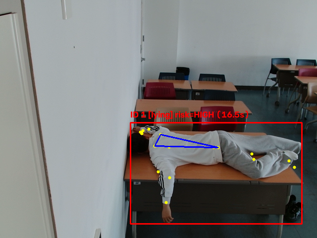
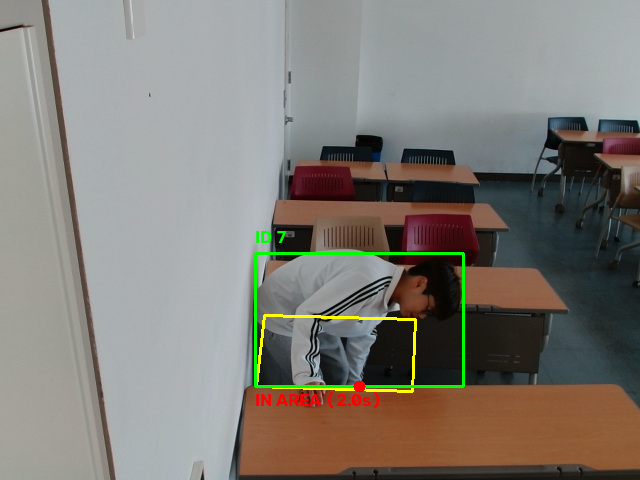
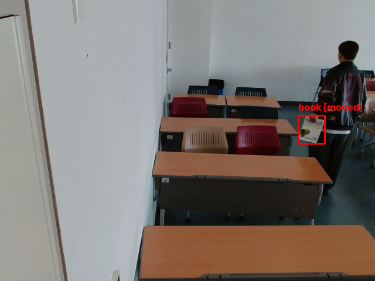
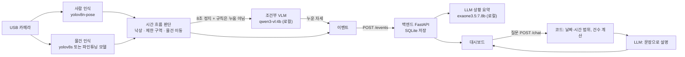

# 연구실 지능형 CCTV

카메라 한 대의 영상에서 **낙상, 제한 구역 접근, 물건 이동**을 시간 흐름으로 판단하고, 이벤트 기록을 **로컬 LLM**이 자연어로 설명하는 연구실용 CCTV 시스템. 규칙이 놓치는 자세는 **조건부 VLM**이 다시 확인한다. (캡스톤 디자인)

**핵심 결과** (개발에 쓰지 않은 시험 데이터 기준)
- **낙상·제한 구역** (학교 시험 영상, 참여자 3명): 옆으로 눕기 낙상 9/9, 제한 구역 접근 8/9, 정상 동작 오경보 0/19. 규칙이 0/6으로 놓친 일직선 눕기는 조건부 VLM으로 4/6을 잡았고, VLM 때문에 생긴 오경보는 0건이었다.
- **물건 이동** (학교 시험 영상 1개, 이동 시도 15번): 15/15 감지, 정상 동작 오경보 0/11. 기존 로직과 기본 모델은 6/15였다. 책 검출 재현율은 현장 파인튜닝으로 43/158에서 149/158이 됐다.
- **LLM 질의응답** (시험용 12문항, 블라인드 채점): 시간 범위와 건수를 코드가 계산해 넘기면 10/12, LLM이 직접 계산하면 6/12. 지어낸 답은 각각 2/12, 4/12. 개발에 한 번 쓰인 T12를 빼면 9/11 대 6/11.

| 낙상 (위험도 HIGH) | 제한 구역 접근 | 물건 이동 |
|---|---|---|
|  |  |  |

(2026-10-14 실시간 화면 캡처. 화면에 나온 사람은 팀원이며 공개에 동의했다.)

**시스템 흐름**



- 실시간 감지는 `src/main.py`, 백엔드는 `backend/app.py`, 대시보드는 `frontend/index.html`이다.
- 사람·물건 인식과 VLM 사진은 그림을 그리기 전 원본 프레임을 쓴다.
- HIGH 이벤트를 Discord로 보내는 기능은 `.env`에 웹훅 주소가 있을 때만 켜진다(선택).

---

## 1. 문제와 설계

### 1-1. 프레임 판단이 아니라 시간 흐름으로 판단한다
**왜:** 한 프레임만 보면 판단이 쉽게 흔들린다.
- 몸을 숙이거나 관절 인식이 한두 프레임 튀어도 "누움"으로 읽힌다.
- 사람이 잠깐 지나가며 가리기만 해도 물건이 "사라짐"으로 보인다.

CCTV 알림에서 필요한 것은 "지금 이 프레임"이 아니라 **"일정 시간 그 상태가 이어졌는가"**다.

**어떻게:**
- **낙상:**
  - 프레임마다 어깨-골반 선의 기울기(45°)로 자세를 본다.
  - 최근 15프레임 중 70% 이상이 같을 때만 상태를 바꾼다.
  - 누운 상태가 5초 이어지면 MEDIUM, 15초면 HIGH로 알린다.
  - 서 있음이 3초 이어지면 회복으로 본다.
  - 몸이 화면 가장자리에 잘린 프레임은 누움 쪽 판단을 보류한다.
  - (`src/events/fall_detector.py`)
- **제한 구역:** 발 위치(사람 박스 아래 가운데)가 구역 안에 **5초 이상** 머물 때만 알린다. (`src/events/intrusion_detector.py`)
- **물건 이동:**
  - 처음 3초 동안 물건의 원래 위치를 잰다.
  - 원래 위치에서 60px 이상 벗어난 상태가 2초 이어지면 "자리 이동"으로 알린다.
  - 4초 동안 안 보이면 "사라짐"으로 알린다.
  - 사람 박스가 원래 위치를 30% 이상 가리고 있으면 사라짐으로 세지 않는다.
  - (`src/events/object_displacement_detector.py`)

### 1-2. 계산은 코드, 설명은 LLM
**왜:** "어제 3시쯤 무슨 일 있었어?", "오늘 몇 건이야?" 같은 질문은 **날짜·시간 범위를 고르고 건수를 세는 계산**이 핵심이다. 개발 중 평가에서 이 계산을 LLM에게 맡기면 시각과 건수를 자주 틀리고 없는 사건을 지어냈다(개발용 23문항, 2-3절).

**어떻게:**
- 코드가 질문에서 날짜·상대 시간·시각을 읽고 해당 범위의 이벤트를 골라 건수를 센다.
- LLM에게는 그 결과(`[시스템 계산 결과] 질문 범위 … 총 N건`)와 이벤트 목록만 넘기고, **문장으로 설명하는 일**만 맡긴다.
- 범위 안에 기록이 없으면 LLM을 부르지 않고 코드가 바로 "기록된 이벤트가 없습니다"라고 답한다.
- (`backend/llm.py` `narrow_events`, `build_chat_prompt`)
- LLM은 로컬 Ollama `exaone3.5:7.8b`다. 영상 기록이 외부로 나가지 않는다.

### 1-3. 조건부 VLM
**왜:**
- 자세 규칙은 어깨-골반 선의 기울기만 보기 때문에, 일부 누운 자세를 서 있음으로 판단한다. 학교 시험 영상의 일직선 눕기 시도에서 규칙 판단은 모두 서 있음이었다.
- 그렇다고 모든 프레임을 VLM에 보내면 느리다. 시험 영상에서 VLM 한 번 응답에 평균 6.2초(16회, 3.5~31.7초)가 걸렸다.

**어떻게:**
- 사람이 **8초 동안 거의 움직이지 않는데**(관절 평균 이동이 박스 긴 변의 5% 이하) **규칙은 누움이 아니라고 할 때만**, 그 사람 부분을 잘라 VLM(로컬 `qwen3-vl:4b-instruct`)에 "누워 있거나 쓰러진 자세입니까?"를 한 번 묻는다.
- "예"면 낙상 의심 이벤트를 만든다.
- 실시간 화면에서는 별도 스레드로 물어서 영상 처리가 멈추지 않는다.
- (`src/events/stillness_trigger.py`, `src/detection/vlm_client.py`)

### 1-4. 현장 파인튜닝 (책 검출)
**왜:**
- 학교 시험 영상에서 기본 모델(yolov8s, COCO)은 책상 위에 가만히 놓인 책을 거의 찾지 못했다. 가만히 둔 3분 구간은 0/37이었다.
- 그래서 책이 잠깐 보였다 사라질 때마다 "사라짐" 오경보가 났다.
- 판단 로직을 고쳐서 될 문제가 아니라 **검출 자체의 문제**였다.

**어떻게:**
- 학교가 아닌 **집에서만** 학습 데이터를 찍었다. 3세션, 588장, 직접 라벨링했다.
- 책과 노트북 2개 클래스로 파인튜닝했다.
- 책 확신도 기준은 집 검증 세션에서 F1이 가장 높은 값(0.78)으로 정했다.
- 학교 영상은 평가에만 썼다. 모델 교체는 `.env`의 `OBJECT_MODEL` 한 줄로 한다.
- 절차는 [docs/DEV_NOTES.md](docs/DEV_NOTES.md)의 "물건 검출 파인튜닝"에 있다.

---

## 2. 결과

모든 숫자는 **분자/분모**로 적었다. 근거 파일 중 `data/replay_results/`는 사람 얼굴이 담긴 녹화에서 나온 로컬 결과라 git에 없다. 숫자마다 계산 방법과 근거 파일은 [docs/VERIFICATION.md](docs/VERIFICATION.md)에 있다.

### 2-1. 낙상·제한 구역 (학교 시험 영상 3명, 2026-11-04 촬영)

| 항목 | 규칙만 | 규칙 + 조건부 VLM |
|---|---|---|
| 옆으로 눕기 낙상 | 9/9 | 9/9 |
| 일직선 눕기 낙상 | **0/6** | **4/6** |
| 낙상 전체 | 9/15 | 13/15 |
| 제한 구역 접근 (5초 이상 머묾) | 8/9 | 8/9 |
| 정상 동작에서 오경보 (지나가기 7, 줍기 6, 앉기 6) | 0/19 | 0/19 |
| 시도 밖·정리 구간 이벤트 | 0 | 0 |

- **감지 기준:** 시도 구간(marks.csv) 안이나 끝난 뒤 2초 안에 이벤트가 나면 감지로 센다.
- **VLM 호출:** 모두 16번이다.
  - "예" 4번은 모두 일직선 눕기 시도 안에서 나왔다.
  - "아니오" 12번에는 **가만히 앉아 있는 장면 6번(앉기 시도 전부)** 이 포함된다. VLM 때문에 생긴 오경보는 없다.
- 근거: `data/replay_results/eval2_people_school_p{1,2,3}_*_test/` (`replay_trials.csv`, `replay_events.csv`, `vlm_calls.csv`, git 밖), [docs/VERIFICATION.md](docs/VERIFICATION.md) 1절

### 2-2. 물건 이동과 책 검출 (학교 시험 영상 1개, 2026-11-04 촬영)

**물건 이동 — 요소별 비교** (같은 영상, 같은 시도 구분, 같은 채점. 이동 시도 15번, 정상 시도 11번)

| 판단 로직 | 물건 모델 | 이동 감지 | 정상 동작 오경보 없음 | 시도 밖 이벤트 |
|---|---|---|---|---|
| 예전 (이동만) | 기본 (책 0.15) | 6/15 | 11/11 | 0 |
| 고친 로직 (사라짐 4초 + 사람 가림 고려) | 기본 (책 0.15) | 14/15 | 7/11 | 7 |
| 예전 (이동만) | 파인튜닝 (책 0.78) | 10/15 | 11/11 | 0 |
| **고친 로직** | **파인튜닝** | **15/15** | **11/11** | **0** |

- **로직만 고친 경우:** 들고 나가는 시도를 잡게 됐지만, 책이 깜빡이듯 검출되면서 오경보가 늘었다.
- **파인튜닝만 한 경우:** 오경보는 없지만, 예전 로직은 "사라짐" 판단이 없어서 들고 나가는 시도 5번(#6~10)을 원래 잡을 수 없다.
- **둘 다 한 경우:** 두 문제가 함께 풀렸다.
- 기준값만 다시 고른 기본 모델(책 0.14)은 고친 로직에서 14/15, 9/11, 시도 밖 7이었다.
- 근거: `data/replay_results/eval2_object_school_20261104_135118_{base,base_f1,ft_v1}/` (git 밖), [docs/VERIFICATION.md](docs/VERIFICATION.md) 2절

**책 검출 재현율** (학교 영상에서 5초 간격으로 뽑은 169장, 정답 책 박스 158개, IoU 0.5 이상)

| 모델 (책 확신도) | 전체 | 가만히 둔 3분 |
|---|---|---|
| 기본 yolov8s (0.15, 기존 시스템) | 43/158 | 0/37 |
| 기본 yolov8s (0.14, 집 검증 세션에서 다시 고름) | 48/158 | 0/37 |
| **파인튜닝 (0.78)** | **149/158** | **37/37** |

- 잘못 찾은 박스는 세 경우 모두 0개다(시스템이 쓰는 프레임당 1개 기준).
- 기준값만 다시 고른 효과는 작고(43→48), 차이는 파인튜닝에서 났다(48→149).
- 근거: `data/detect_eval/eval2_object_school_20261104_135118_{yolov8s_baseline,yolov8s_base_f1,book_laptop_v1_ft_v1}/summary.csv`, `data/threshold_select/`

### 2-3. LLM 질의응답

**시험용 12문항 (대표 결과)** — 조건 이름을 가리고 A/B 순서를 섞은 시트로 블라인드 채점

| 조건 | 정확 (O / △ / X) | 점수 | 지어낸 답 |
|---|---|---|---|
| **계산 결과 넣음** (현재 설계: 코드가 범위·건수 계산) | 10 / 0 / 2 | **10/12** | **2/12** |
| 계산 결과 뺌 (LLM이 기록에서 직접 계산) | 6 / 0 / 6 | 6/12 | 4/12 |

- 채점: O=1, △=0.5, X=0. 이번에는 △가 없어서 점수와 정답 수가 같다.
- 모델: 로컬 `exaone3.5:7.8b`. 답을 만들 때 이벤트 시각 표시는 24시간제 형식(`시각 11:02:30`)이었다.
- 근거: `data/llm_eval/run_20261111_235156_grounding_ollama_exaone3.5-7.8b/summary.csv`, `grading_sheet_graded.csv`, `answer_key.csv`, [data/llm_eval/EVAL_NOTES.md](data/llm_eval/EVAL_NOTES.md)

**T12는 완전히 떼어 둔 문항이 아니다.**
- 시험용 12문항 중 T12("오늘 제한 구역 접근은 어떻게 판단한 거야?")는 최종 평가(2026-11-11) 전에 개발에 쓰였다.
- 2026-11-05에 LLM이 이 문항에서 시각의 초(11시 2분 **30초**)를 머문 시간으로 읽는 것을 보고, 시각 표시 형식을 24시간제로 바꿨다.
- 그래서 T12를 뺀 11문항의 숫자도 함께 싣는다.

| 조건 | 12문항 | T12 제외 11문항 |
|---|---|---|
| 계산 결과 넣음 | 10/12, 지어냄 2/12 | **9/11**, 지어냄 2/11 |
| 계산 결과 뺌 | 6/12, 지어냄 4/12 | **6/11**, 지어냄 3/11 |

**시각 표시 형식에 따른 차이** (2026-11-05 생성, 35문항 = 개발용 23 + 시험용 12. 모두 "계산 결과 넣음" 경로)

| 질문 | 예전 형식 `[11시 2분 30초]` | 24시간제 형식 `시각 11:02:30` |
|---|---|---|
| 개발용 23문항 | 22/23, 지어냄 1/23 | 22/23, 지어냄 0/23 |
| 시험용 12문항 | 11/12, 지어냄 1/12 | 10/12, 지어냄 2/12 |
| 시험용 T12 제외 11문항 | 11/11, 지어냄 0/11 | 9/11, 지어냄 2/11 |

- 24시간제 형식은 T12와 개발용 Q09를 고쳤지만, "1시쯤", "3시 20분쯤" 같은 질문을 13시, 15시 기록과 맞추지 못하는 실수(Q01, T02)를 새로 만들었다. 날짜를 지어낸 T06도 이 형식에서만 틀렸다.
- 그래서 **실제 시스템(전시회)은 예전 형식을 쓴다** (`backend/llm.py` `LEGACY_TIME_FORMAT = True`, 2026-11-12). 위 대표 결과(10/12)는 24시간제 형식으로 측정한 값이다.
- 이 비교(2026-11-05 생성)는 두 형식의 답을 한 번씩 생성해, **개발자 1인이 A/B 조건을 가린 상태로** 채점했다.
- 따라서 전시회에서 쓰는 예전 형식의 시험용 결과는 **11/12 (T12 제외 11/11)** 이다.
- 다만 개발자가 분석 과정에서 이 12문항의 내용을 이미 봤으므로, 완전히 새로운 질문으로 한 평가는 아니다.
- 근거: `data/llm_eval/run_20261105_213619_timefmt_ollama_exaone3.5-7.8b/` (`summary.csv`, `grading_sheet_graded.csv`, `answer_key.csv`)

**개발용 23문항 (참고: 개발 중 사용)** — 문제를 찾고 설계를 정하는 데 쓴 질문이라 대표 숫자로 쓰지 않는다.

| 조건 | 정확 (O / △ / X) | 점수 | 지어낸 답 |
|---|---|---|---|
| 계산 결과 넣음 | 21 / 2 / 0 | 22/23 | 1/23 |
| 계산 결과 뺌 | 7 / 3 / 13 | 8.5/23 | 3/23 |

- 근거: `data/llm_eval/run_20261101_182940_ollama_exaone3.5-7.8b/summary.csv`
- 이 결과 뒤에 LLM 코드가 바뀌었다(시각 표시 형식 등). 그래서 커밋 `6c60a50` 시점 코드의 결과다.

---

## 3. 평가 방식

- **개발용과 시험용 분리:**
  - 사람 판단은 2026-11-03 집 영상(1명)으로 개발했고, 2026-11-04 학교 영상(3명)으로 시험했다.
  - 물건 판단과 파인튜닝은 집에서 찍은 데이터로 개발·학습했고, 학교 영상 1개로 시험했다. 학습·검증 데이터 588장(학습 470, 검증 118) 중 학교 프레임은 0장이다. 데이터셋 도구가 학교 경로를 거부한다.
  - LLM은 개발용 23문항과 시험용 12문항을 썼다. 다만 시험용 중 **T12는 최종 평가 전에 시각 표시 형식을 바꾸는 근거로 쓰였다**(2026-11-05). 그래서 T12를 뺀 11문항 결과도 함께 적었다(2-3절).
- **설정은 결과를 보기 전에 커밋으로 확정:**
  - 사람 판단 설정(VLM 질문, 8초, 5%, 3프레임, 가장자리 5px)은 촬영 전날 커밋 `9bda547`(2026-11-03 17:31)로 확정했다(아래 표). 촬영 뒤 사람 판단 코드는 바뀌지 않았다.
  - 책 확신도 기준(파인튜닝 0.78, 비교용 기본 0.14)은 집 검증 세션에서만 골라 커밋 `8e5981e`(2026-11-06 22:01:08)로 기록했다. 학교 영상 채점은 그 뒤(22:01:43, 22:02:01)에 했다.
- **블라인드 채점 (LLM):**
  - 두 조건의 답을 문항마다 A/B로 섞고 조건 이름을 가린 시트로, 팀원 1명이 채점했다. 채점 중 키 파일은 열지 않았다.
  - 시험용은 A/B 순서를 새 무작위 시드로 섞었고, 키 파일을 시트와 다른 폴더에 두었다.
  - 판정 기준(O/△/X, 지어냄)은 시험용 채점 전에 글로 정리했다. 개발용 채점 때는 기준을 글로 남기지 않았다.
  - **한계:** "계산 결과 넣음" 조건은 범위 안에 기록이 없으면 코드가 고정 문장으로 답한다. 시험용 12문항 중 2문항이 그런 답이라, 문장 모양으로 조건을 짐작할 수 있었다. 채점자 1명, 답 생성 1회의 결과다.

<details>
<summary>평가 설정 (확정: 2026-11-03, 새 영상 검증 전 고정)</summary>

2026-11-03 녹화 영상은 개발용으로만 쓰고, 아래 값은 새 영상 결과를 보고 다시 바꾸지 않는다.

| 항목 | 값 | 위치 |
|---|---|---|
| VLM 질문 문구 | 이 사람이 누워 있거나 쓰러진 자세입니까? 장소(바닥, 매트 등)와 상관없이 자세만 보고 예/아니오로 답하고 근거를 짧게 적어주세요. | `src/detection/vlm_client.py` `QUESTION` |
| VLM 호출: 정지 시간 | 8초 | `StillnessTrigger(still_seconds=8)` |
| VLM 호출: 정지 기준 | 관절 평균 이동이 사람 박스 긴 변의 5% 이하 | `StillnessTrigger(motion_ratio=0.05)` |
| VLM 호출: 튐 무시 | 기준을 넘는 움직임이 연속 3프레임 이상일 때만 정지 시간 초기화 | `StillnessTrigger(reset_frames=3)` |
| 화면 가장자리 보류 | 사람 박스가 상하좌우 5픽셀 이내에 닿은 프레임은 **누움 쪽 판단만 보류**: '누움' 투표와 새 경보 발생을 막고, '서 있음' 투표와 회복(서 있음 3초 → 사건 종료)은 인정. VLM은 호출하지 않음 (규칙만 / 규칙+VLM 공통). 화면에 EDGE 표시 | `src/events/fall_detector.py` `EDGE_MARGIN`, `FallDetector.update(hold=)` |
| VLM 모델 | 로컬 Ollama `qwen3-vl:4b-instruct` (`.env`의 `VLM_MODEL`) | `src/config.py` |

가장자리 처리 변경 (2026-11-03, B안): 처음에는 가장자리 프레임의 모든 자세 판단을 보류했으나, 서 있는 사람은 화면 위아래 끝에 닿기 쉬워 일어선 프레임까지 보류되면서 자세 상태가 '누움'으로 멈추고 회복이 인정되지 않았다(개발용 영상에서 옆 눕기 여러 시도가 한 사건으로 묶임). 잘린 몸 때문에 생기는 낙상 오경보를 막는다는 목적은 누움 쪽만 보류해도 지켜지므로 B안으로 확정. 5픽셀 값은 그대로 유지.

</details>

---

## 4. 한계

- **실험 규모가 작다.**
  - 사람 판단의 개발 영상은 1명이고, 시험 영상은 3명이 시도별로 2~3번씩 했다. 일직선 눕기는 6번뿐이다.
  - 물건 판단과 책 검출은 학교 영상 1개(이동 시도 15번)의 결과다.
  - LLM 시험은 12문항이라, 1문항이 8.3%포인트다.
- **같은 책이 학습에 들어 있다.** 학교 영상에서 감시한 책을 집 학습·검증 데이터에도 넣었다. 그래서 책 검출 결과는 "같은 책, 처음 보는 장소"에서의 성능이고, 처음 보는 책에 대한 성능은 확인하지 않았다.
- **일직선 눕기 2번은 VLM이 불리지 않았다.** 참여자 1명(p3)의 일직선 눕기 2번에서는 VLM이 한 번도 불리지 않았다. 4/6의 실패 2번이 이 경우다. 정지 조건(8초, 5%)이 만족되지 않았는지, 화면 가장자리 보류 때문인지는 아직 분석하지 않았다. (TODO)
- **LLM이 틀린 2문항 (시험용, 계산 결과 넣음 조건):** 두 경우 모두 코드는 맞는 범위와 건수를 넘겼는데 LLM이 그것을 따르지 않았다.
  - T02 "어제 3시 20분쯤 무슨 일 있었어?": 코드가 "어제 15시 20분 전후 15분, 총 1건(물건 이동)"을 넘겼는데도 LLM이 "해당하는 기록이 없다"고 답했다.
  - T06 "어제 제한 구역에 들어온 사람 있어?": 사람(Person #02)과 시각(10:12:40)은 맞았지만, 프롬프트의 "질문 범위: 어제(11월 2일)"와 달리 날짜를 "10월 31일"로 지어냈다.
  - 두 문항 모두 24시간제 시각 형식에서 틀렸다. 2026-11-05에 예전 형식으로 생성한 답에서는 두 문항 모두 O였다(2-3절). 지금 실제 시스템은 예전 형식을 쓴다. 예전 형식의 시험용 결과(11/12)는 개발자 본인이 조건을 가리고 채점한 것으로, 문항 내용을 이미 본 상태였다.
  - 대시보드 기본값에서는 LLM 답변을 기록과 대조하는 검증 장치(`backend/verify.py`)를 쓰지 않는다. 이 장치의 효과는 아직 평가하지 않았다.
- **실시간 VLM은 늦게 뜬다.** 재생 평가는 VLM 답을 기다리며 영상을 멈추고 셌다. 실시간에서는 응답 시간(평균 6.2초)만큼 알림이 늦다.

---

## 5. 실행 방법

### 환경 (Python 3.12)
```
conda create -n lab-cctv python=3.12 -y
conda activate lab-cctv
python -m pip install torch torchvision --index-url https://download.pytorch.org/whl/cu121   # 본인 CUDA에 맞게
python -m pip install -r requirements.txt
```
`.env.example`을 복사해 `.env`를 만든다. YOLO 모델 파일(`*.pt`)은 처음 실행할 때 자동으로 받는다.

### 새로 받은 저장소에서 바로 되는 것
| 무엇 | 명령 | 필요한 것 |
|---|---|---|
| LLM 답변 검증 장치 테스트 (9개) | `python -m tests.test_verify` | 없음 (카메라, LLM 불필요) |
| 백엔드 + 대시보드 | `uvicorn backend.app:app` → `http://127.0.0.1:8000/` | 카메라 불필요. LLM 요약·질문 답변에는 Ollama + `ollama pull exaone3.5:7.8b` |
| LLM 평가 다시 돌리기 | `python -m src.experiments.llm_eval.run_eval --questions src/experiments/llm_eval/questions_test.json` → 채점 → `score_eval` | Ollama + `exaone3.5:7.8b`. 평가용 이벤트 DB(`data/llm_eval/eval_events.db`)는 저장소에 있다. 지금 코드는 예전 시각 형식(`LEGACY_TIME_FORMAT = True`)이라, 대표 결과(10/12, 24시간제 형식)와 같은 조건이 아니다 |

### 카메라나 녹화 파일이 있어야 되는 것
| 무엇 | 명령 | 필요한 것 |
|---|---|---|
| 실시간 감지 화면 | `python -m src.main` | **USB 카메라** (`.env`의 `CAMERA_INDEX`). 지금 코드는 영상 파일 입력을 받지 않는다. VLM에는 `ollama pull qwen3-vl:4b-instruct` |
| 한 번에 실행 (데모) | Windows `scripts\start_demo.ps1` / Mac·Linux `scripts/start_demo.sh` | 카메라 + Ollama |
| 녹화 재생 평가, 시연 영상 만들기 | `src.experiments.replay_eval`, `src.tools.render_video` | 녹화 폴더(`video.mp4`, `frames.csv`, `marks.csv`). 사람 얼굴이 담겨 있어 **저장소에 없다**. 직접 녹화하려면 `src.tools.recorder` |
| 책 검출 평가, 기준값 고르기 | `src.experiments.detect_eval`, `pick_threshold` | 라벨링한 프레임과 학습된 모델. **저장소에 없다** |

설정 변경 이력, 파인튜닝 절차, 시연 도구 사용법은 [docs/DEV_NOTES.md](docs/DEV_NOTES.md)에 있다.

---

## 6. 역할

캡스톤 디자인 3인 팀 프로젝트다. 기획, 설계, 구현, 실험은 1인(immmingyu)이 단독으로 했다. 팀원은 실험 영상 촬영 참여와 LLM 평가의 블라인드 채점을 도왔다.
